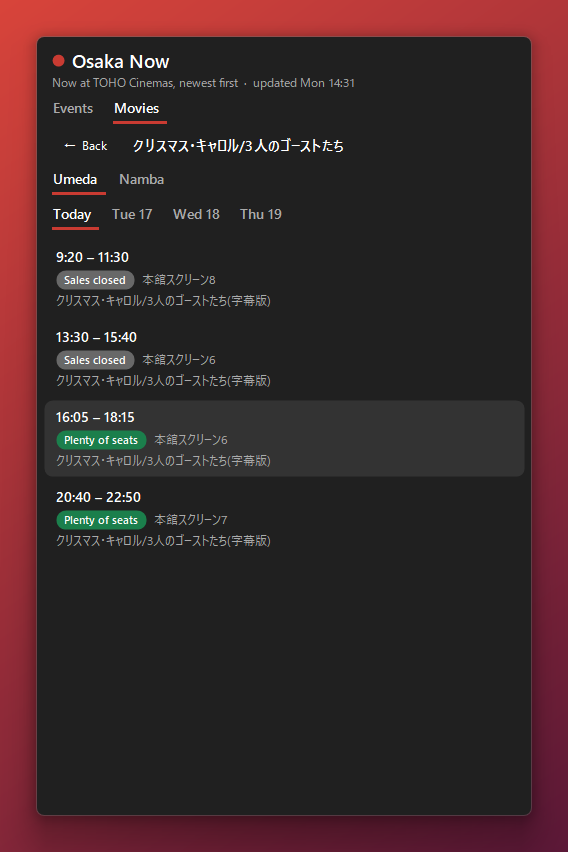

<div align="center">


# Osaka Now

**What's on in Osaka, one click from your Windows taskbar.**

Events worth going out for and TOHO Cinemas showtimes with live seat availability,<br>
in a 62 KB system tray app with no installer, no account and no dependencies.

[](https://github.com/ian-ledig/osaka-now/actions/workflows/build.yml)
[](https://github.com/ian-ledig/osaka-now/releases/latest)
[](https://github.com/ian-ledig/osaka-now/releases)
[](LICENSE)


[**Download**](https://github.com/ian-ledig/osaka-now/releases/latest) · [What it does](#what-it-does) · [Install](#install) · [How it works](#how-events-are-sorted) · [日本語](#日本語)

<br>




</div>

The interface is in English. Event and film titles stay in Japanese, the way the sites publish them.

## What it does

- Lists events in Osaka prefecture for the next 45 days. Things that happen soon and things that suit a date (illuminations, fireworks, autumn leaves, food fairs, markets, exhibitions, concerts) come first. Kids' events and seminars end up near the bottom.
- Lists the films now showing at TOHO Cinemas, most recent release first.
- Click a film to see its showtimes at Umeda or Namba on a day you choose, with the seat status of each showing. Clicking a showing opens TOHO's seat selection page for it in your browser.
- Refreshes in the background every six hours. If a refresh finishes while the window is open, the list is left as it is until you open it again.
- Follows the Windows light or dark setting.

## Install

You need Windows 10 or 11. The .NET Framework it runs on is already part of Windows.

1. Download `OsakaNow.exe` from the [latest release](https://github.com/ian-ledig/osaka-now/releases/latest).
2. Put it in a folder you will keep, for example `Documents\OsakaNow`, and double-click it. The exe is not code-signed, so SmartScreen may stop it the first time: choose *More info*, then *Run anyway*.
3. A red dot appears in the system tray. Windows puts new icons under *Show hidden icons* (the `^` arrow). Drag the dot onto the taskbar if you want it always visible.
4. Right-click the dot and tick *Start with Windows*.

Using it:

- Left-click the tray icon to open or close the list.
- Click an event to open its page in your browser.
- Click a film for its showtimes. `Esc` or `Backspace` goes back.
- Right-click the tray icon for *Refresh now*, *Start with Windows* and *Exit*.

To uninstall, untick *Start with Windows*, choose *Exit*, then delete the exe and the folder `%LOCALAPPDATA%\OsakaNow`.

## How events are sorted

Each event gets a score, and the list is sorted by it.

Most of the score is about time. A short event that is on right now scores highest, then one that ends within a week, then upcoming events by how near they are. Long-running events that are open for months score lower, so they don't sit at the top forever.

The rest comes from keywords in the title and description. There is a list of keyword groups that add points (illumination, fireworks, Christmas, autumn leaves, flowers, food and drink, markets, art, music, festivals) and a list that subtracts (children, family, seminars, and similar). Small bonuses go to events that cover the coming weekend and to events the source sites rank as popular.

Both lists are plain arrays at the top of [`OsakaNow.cs`](OsakaNow.cs). If dates are not what you are planning, replace the words and rebuild.

## Where the data comes from

| Data | Source | When |
| --- | --- | --- |
| Events | [Walkerplus](https://www.walkerplus.com/event_list/ar0727/) and [Jalan](https://www.jalan.net/event/270000/) listings for Osaka prefecture | 10 pages every 6 hours |
| Films now showing | [TOHO Cinemas](https://www.tohotheater.jp/) | 1 request every 6 hours |
| Release dates | [eiga.com](https://eiga.com/now/), matched by title | Only for films it has not seen before |
| Showtimes and seats | TOHO Cinemas schedule service | When you click a film |

Requests are spaced one second apart. Thumbnails are downloaded once, kept as small JPEGs, and deleted after 30 days.

The app does not collect or send anything about you. The sites above are the only hosts it contacts, and the only thing it writes is a cache in `%LOCALAPPDATA%\OsakaNow`.

## Build from source

You don't need Visual Studio or an SDK. `build.cmd` uses the C# compiler that comes with Windows.

```bat
git clone https://github.com/ian-ledig/osaka-now.git
cd osaka-now
build.cmd
OsakaNow.exe
```

Two switches are useful when you change something:

```bat
OsakaNow.exe --selftest
OsakaNow.exe --dump > ranking.txt
```

`--selftest` runs offline checks on the parsing, the sorting and the link validation. `--dump` fetches everything once and prints both lists with their scores.

## Changing things

The settings are constants at the top of the `Core` class in [`OsakaNow.cs`](OsakaNow.cs):

- `Likes` and `Dislikes`: the keyword groups that raise or lower an event.
- `Sources`: the listing pages to read. Any Walkerplus or Jalan area page works, so Kyoto, Kobe or Tokyo is a matter of changing the URLs.
- `Theaters`: the TOHO Cinemas offered in the showtimes view. `037` is Umeda and `032` is Namba.
- `RefreshHours`, `HorizonDays`, `MaxShown`: refresh interval, how far ahead to look, and how many rows to show.

## Limitations

- It reads public web pages. If one of the sites changes its layout, a tab can come up empty until the parser is fixed. Please [open an issue](https://github.com/ian-ledig/osaka-now/issues/new/choose) if that happens.
- TOHO does not publish release dates, so they are looked up on eiga.com by title. A few films, mostly re-runs, don't match and are sorted last.
- The Movies tab lists everything TOHO is showing in Japan. A film may have no showings at Umeda or Namba.
- Japanese public holidays are not treated as weekends.
- Dark mode is the one that has been used day to day. Light and high-contrast modes are less tested, and it has not been tried with a screen reader.

## Contributing

Issues and pull requests are welcome. [CONTRIBUTING.md](CONTRIBUTING.md) has the few rules there are.

## 日本語

大阪のイベントと、TOHOシネマズ梅田・なんばの上映時間（空席状況つき）を、タスクトレイから見られる Windows 用の小さなアプリです。

- 大阪府内のイベントを、開催日が近いものやデート向きのもの（イルミネーション、花火、紅葉、グルメ、マルシェ、展覧会など）から順に表示します。
- TOHOシネマズで上映中の作品を、公開日が新しい順に表示します。
- 作品をクリックすると、梅田・なんばの上映時間と空席状況を日付ごとに確認できます。
- インストールは不要です。[最新リリース](https://github.com/ian-ledig/osaka-now/releases/latest)から `OsakaNow.exe` をダウンロードして起動してください。

画面の表示は英語ですが、イベント名と作品名は日本語のまま表示されます。Windows 10 / 11 で動きます。

## Disclaimer

This is an unofficial project. It is not affiliated with TOHO Cinemas, Walkerplus, Jalan or eiga.com. The event details, film information and images shown in the app and in the screenshots above belong to their owners. Check dates and tickets on the official pages the app links to.

## License

[MIT](LICENSE)
