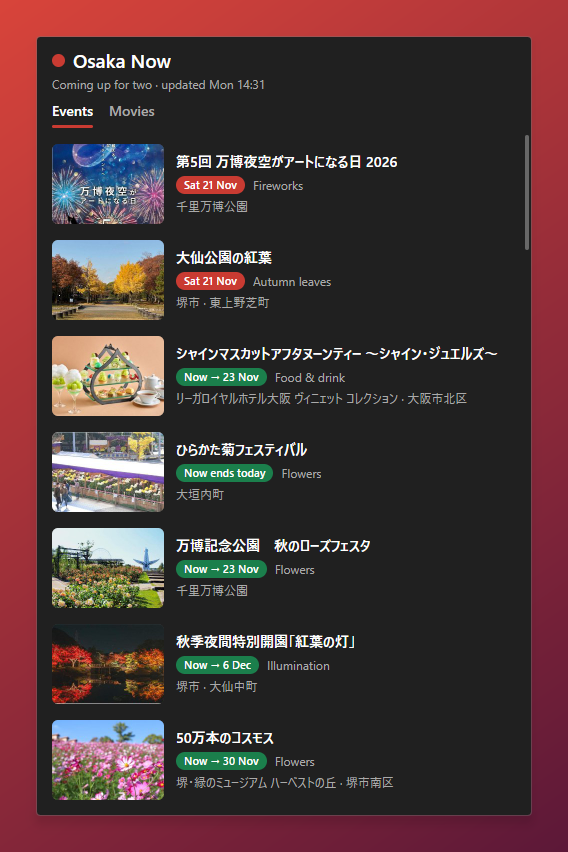
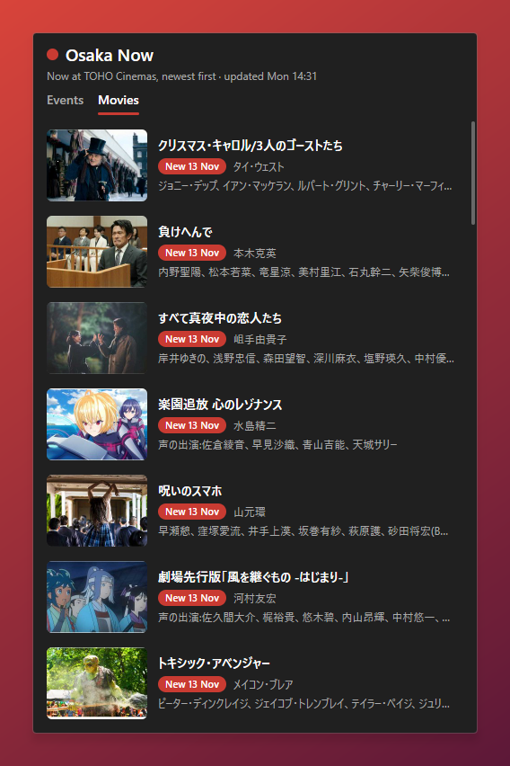

<div align="center">


# Osaka Now

**What's on in Osaka, one click from your taskbar or menu bar.**

Events worth going out for and TOHO Cinemas showtimes with live seat availability,<br>
in a small tray app for Windows, macOS and Linux.

[](https://github.com/ian-ledig/osaka-now/actions/workflows/build.yml)
[](https://github.com/ian-ledig/osaka-now/releases/latest)
[](https://github.com/ian-ledig/osaka-now/releases)
[](LICENSE)


[**Download**](https://github.com/ian-ledig/osaka-now/releases/latest) · [What it does](#what-it-does) · [Install](#install) · [How it works](#how-events-are-sorted) · [日本語](#日本語)

<br>





</div>

Hi! I'm a young adult living in Osaka, trying to enjoy the city after work and on weekends. I made this small app for myself, to see quickly what's on around here. If you live in Osaka too, I hope it gets you out a bit more.

The interface is in English. Event and film titles stay in Japanese, the way the sites publish them.

## What it does

- Lists events in Osaka prefecture for the next 45 days. Things that happen soon and things that suit a date (illuminations, fireworks, autumn leaves, food fairs, markets, exhibitions, concerts) come first. Kids' events and seminars end up near the bottom.
- Lists the films now showing at TOHO Cinemas, most recent release first.
- Click a film to see its showtimes at Umeda or Namba on a day you choose, with the seat status of each showing. Clicking a showing opens TOHO's seat selection page for it in your browser.
- Refreshes in the background every six hours. If a refresh finishes while the window is open, the list is left as it is until you open it again.
- Follows the system's light or dark setting.

## Install

Download the file for your system from the [latest release](https://github.com/ian-ledig/osaka-now/releases/latest). There is no account and nothing to configure.

### Windows

Download `OsakaNow-windows-x64.exe`, put it in a folder you will keep, and double-click it. The file is not code-signed, so SmartScreen may stop it the first time: choose *More info*, then *Run anyway*.

A red dot appears in the system tray. Windows puts new icons under *Show hidden icons* (the `^` arrow); drag the dot onto the taskbar if you want it always visible.

It uses the WebView2 runtime, which is part of Windows 11 and of any Windows 10 that is up to date.

### macOS

Download `OsakaNow-macos-universal.zip` (it works on both Apple silicon and Intel Macs), unzip it and move `OsakaNow.app` to *Applications*.

The app is not notarized by Apple, so the first launch needs one extra step: right-click the app, choose *Open*, then *Open* again. If macOS still refuses, run this once in Terminal:

```sh
xattr -cr /Applications/OsakaNow.app
```

The red dot appears in the menu bar. There is no Dock icon.

### Linux

Pick the package for your distribution:

```sh
sudo apt install ./OsakaNow-linux-x64.deb      # Debian, Ubuntu
sudo dnf install ./OsakaNow-linux-x64.rpm      # Fedora
chmod +x OsakaNow-linux-x64.AppImage && ./OsakaNow-linux-x64.AppImage
```

It needs GTK 4 and WebKitGTK 6, which the `.deb` and `.rpm` pull in by themselves. On GNOME, tray icons only show with the [AppIndicator extension](https://extensions.gnome.org/extension/615/appindicator-support/).

### Using it

- Click the tray icon to open or close the list. Right-click it for *Open*, *Refresh now*, *Start at login* and *Quit*.
- Click an event to open its page in your browser.
- Click a film for its showtimes. `Esc` or `Backspace` goes back.
- Starting the app a second time opens the window of the one already running.

To remove it, untick *Start at login*, choose *Quit* and delete the app. Its cache is the `OsakaNow` folder in `%LocalAppData%` (Windows), `~/Library/Caches` (macOS) or `~/.cache` (Linux).

## How events are sorted

Each event gets a score, and the list is sorted by it.

Most of the score is about time. A short event that is on right now scores highest, then one that ends within a week, then upcoming events by how near they are. Long-running events that are open for months score lower, so they don't sit at the top forever.

The rest comes from keywords in the title and description. There is a list of keyword groups that add points (illumination, fireworks, Christmas, autumn leaves, flowers, food and drink, markets, art, music, festivals) and a list that subtracts (children, family, seminars, and similar). Small bonuses go to events that cover the coming weekend and to events the source sites rank as popular.

Both lists are in [`internal/feed/tuning.go`](internal/feed/tuning.go). If dates are not what you are planning, replace the words and rebuild.

## Where the data comes from

| Data | Source | When |
| --- | --- | --- |
| Events | [Walkerplus](https://www.walkerplus.com/event_list/ar0727/) and [Jalan](https://www.jalan.net/event/270000/) listings for Osaka prefecture | 10 pages every 6 hours |
| Films now showing | [TOHO Cinemas](https://www.tohotheater.jp/) | 1 request every 6 hours |
| Release dates | [eiga.com](https://eiga.com/now/), matched by title | Only for films it has not seen before |
| Showtimes and seats | TOHO Cinemas schedule service | When you click a film |

Requests are spaced one second apart. Thumbnails are downloaded once, kept as small JPEGs, and deleted after 30 days.

The app does not collect or send anything about you. The sites above are the only hosts it contacts, and the only thing it writes is its cache folder.

## Build from source

The app is written in Go with [Wails 3](https://wails.io/): Go does the fetching and ranking, and the window is a small web page in the system's own web view. You need [Go](https://go.dev/dl/) 1.26 or newer and [Node.js](https://nodejs.org/).

```sh
git clone https://github.com/ian-ledig/osaka-now.git
cd osaka-now
go install github.com/wailsapp/wails/v3/cmd/wails3@v3.1.0
wails3 build
```

The result is in `bin/`. On Linux, install the headers first: `sudo apt install libgtk-4-dev libwebkitgtk-6.0-dev`.

Useful while working on it:

```sh
wails3 dev               # run with live reload
go test ./internal/...   # run the tests
bin/OsakaNow --dump      # fetch everything once and print both lists with their scores
```

[CONTRIBUTING.md](CONTRIBUTING.md) explains where things are.

## Changing things

The settings are in [`internal/feed/tuning.go`](internal/feed/tuning.go):

- `Likes` and `Dislikes`: the keyword groups that raise or lower an event.
- `Sources`: the listing pages to read. Any Walkerplus or Jalan area page works, so Kyoto, Kobe or Tokyo is a matter of changing the URLs.
- `Theaters`: the TOHO Cinemas offered in the showtimes view. `037` is Umeda and `032` is Namba.
- `RefreshHours`, `HorizonDays`, `MaxShown`: refresh interval, how far ahead to look, and how many rows to show.

## Limitations

- I made it and use it on Windows. The macOS and Linux versions are built and started automatically for every release, but they have had much less real use, so please [report](https://github.com/ian-ledig/osaka-now/issues/new/choose) anything odd.
- It reads public web pages. If one of the sites changes its layout, a tab can come up empty until the parser is fixed.
- TOHO does not publish release dates, so they are looked up on eiga.com by title. A few films, mostly re-runs, don't match and are sorted last.
- The Movies tab lists everything TOHO is showing in Japan. A film may have no showings at Umeda or Namba.
- Japanese public holidays are not treated as weekends.
- The window is a web view, so it uses more memory than a native tray app would: around 200 MB on Windows while it is running.
- The downloads are not signed, which is why Windows and macOS ask before the first launch.

## Contributing

Issues and pull requests are welcome. [CONTRIBUTING.md](CONTRIBUTING.md) has the few rules there are.

## 日本語

大阪のイベントと、TOHOシネマズ梅田・なんばの上映時間（空席状況つき）を、タスクトレイやメニューバーから見られる小さなアプリです。Windows・macOS・Linux で動きます。

- 大阪府内のイベントを、開催日が近いものやデート向きのもの（イルミネーション、花火、紅葉、グルメ、マルシェ、展覧会など）から順に表示します。
- TOHOシネマズで上映中の作品を、公開日が新しい順に表示します。
- 作品をクリックすると、梅田・なんばの上映時間と空席状況を日付ごとに確認できます。
- [最新リリース](https://github.com/ian-ledig/osaka-now/releases/latest)から、お使いの OS 用のファイルをダウンロードしてください。

画面の表示は英語ですが、イベント名と作品名は日本語のまま表示されます。

## Disclaimer

This is an unofficial project. It is not affiliated with TOHO Cinemas, Walkerplus, Jalan or eiga.com. The event details, film information and images shown in the app and in the screenshots above belong to their owners. Check dates and tickets on the official pages the app links to.

## License

[MIT](LICENSE)
